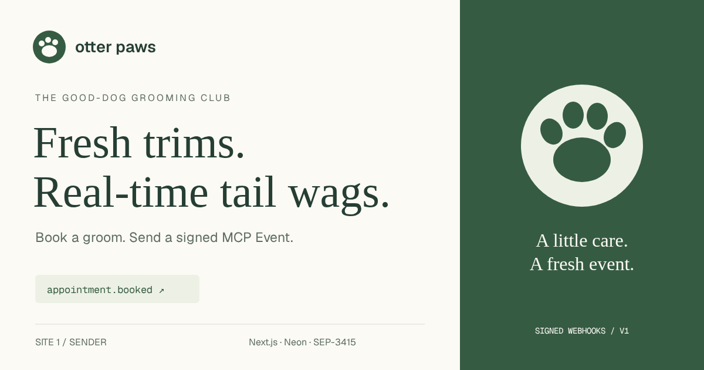
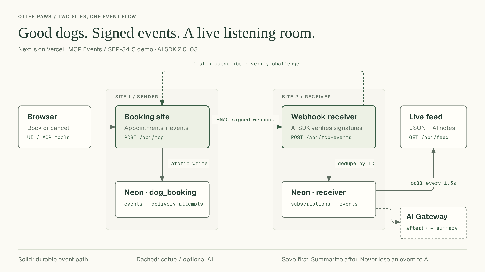

# Otter Paws · MCP Events booking sender

A dog-grooming booking site that sends signed `appointment.booked` and `appointment.cancelled` webhooks. This is the sender half of a two-site MCP Events / SEP-3415 demo: book or cancel an appointment, watch its signed delivery, then see it arrive in the receiver's live feed with an optional AI summary. Built with Next.js 16.4.6 App Router, React, Tailwind, TypeScript, and Neon Postgres via `@neondatabase/serverless`; tested against **`@ai-sdk/mcp@2.0.103`**.

**Tags:** `mcp` `mcp-events` `sep-3415` `vercel-ai-sdk` `nextjs` `neon` `webhooks` `demo`

**Live:** [Booking sender](https://mcp-events-dog-booking.vercel.app) · [Events receiver](https://mcp-events-receiver-two.vercel.app) · [Receiver source](https://github.com/focusOtter/mcp-events-receiver/tree/devin/receiver)

> **Demo tip:** Receiver subscriptions last **24 hours**. Before a talk, open the receiver and click **Subscribe to events** (or **Refresh subscriptions** if already subscribed), then confirm **2/2 active** before booking.

## How it works



1. **Subscribe:** In the receiver, the Subscribe server action creates an AI SDK HTTP MCP client, calls `events/list`, then subscribes to both appointment events through this site's `POST /api/mcp`. The SDK's private subscription record and secret are saved in the receiver's Neon database.
2. **Verify challenge:** Before activating a subscription, this server sends a signed `{ "type": "verification", "challenge": "…" }` POST to the receiver's `/api/mcp-events`. The AI SDK verifies the signature and echoes the challenge.
3. **Book:** Book a fictional dog in this site's browser UI (or call `book_appointment` through MCP). Appointment and event creation happen atomically in Neon `dog_booking`. Cancelling follows the same path with `appointment.cancelled`.
4. **Signed webhook:** The server awaits delivery to matching, active subscribers with Standard Webhooks HMAC-SHA256 headers, bounded retries and a persisted delivery-attempt log. The body is `{eventId,name,timestamp,data,cursor}`.
5. **Receiver feed:** `experimental_createMCPEventWebhook` verifies the delivery, then stores it in Neon `receiver`, deduped by `eventId`. The feed polls every 1.5 seconds and highlights arrivals. Only after persistence, Next.js `after()` optionally generates an AI Gateway summary; AI failure never blocks the event write.

Diagram source: [HTML](docs/architecture.html) · [SVG](docs/architecture.svg). Social-card source: [HTML](docs/og.html). The diagram uses the approved Otter Paws cream-and-forest palette, Georgia headings and Geist / Geist Mono; the editable HTML/SVG loads the latter from Google Fonts. PNGs have no runtime font dependency.

## Compatibility notes

These are deliberate interoperability accommodations for **AI SDK MCP 2.0.103**, not a claim of full SEP-3415 support.

| AI SDK vs. SEP-3415 | Server accommodation |
| --- | --- |
| The SDK checks top-level `capabilities.events`; SEP-3415 uses `capabilities.extensions["io.modelcontextprotocol/events"]`. | Advertises both shapes, intentionally, so the SDK enables its Events API while extension-aware clients can discover the SEP capability. |
| The SDK requires `webhook-id == eventId`; Standard Webhooks message identity need not otherwise equal the event identity. | Sets the header to the payload's `eventId` and signs that exact ID, timestamp and body. Retries keep the event ID. |
| The SDK omits the SEP's `Mcp-Name` header on Events requests. | Does not require the header; dispatches the explicitly named `events/*` JSON-RPC methods at `/api/mcp`. |
| The SDK exposes webhook delivery, not Events poll/stream transports. | Advertises only `delivery: ["webhook"]`; implements subscribe/unsubscribe and signed callbacks, not poll/stream or historical replay. Browser feed polling is ordinary application HTTP, not MCP Events polling. |

The server also accepts both modern `server/discover` and the legacy `initialize` exchange used by this SDK. Details and demo limitations are below.

## Local setup

Requires Node 24. Store a Neon Postgres connection string in the **gitignored** `.env.local`:

```dotenv
DATABASE_URL=<your Neon connection string>
```

```sh
source ~/.nvm/nvm.sh && nvm use 24
npm ci
npm run db:setup       # idempotent: tables + indexes, safe to repeat
npm run dev -- --hostname 127.0.0.1
```

Open http://127.0.0.1:3000. Date/time entry uses your local timezone; the appointment list labels UTC explicitly. Book or cancel in the UI; recent events, per-subscriber delivery attempts and active subscription count refresh every five seconds.

Provisioned project: **mcp-events-spike**, ID `silent-shape-25570154`, database `dog_booking`, Michael's `mtliendo@focusotter.com` Neon organization, AWS us-east-2. Credentials are not committed. Use a direct connection for schema setup; the application's HTTP driver is stateless and does not hold a connection pool open.

## Checks

```sh
npm test
npx tsc --noEmit
npm run lint
npm run build
```

With `next dev` running on **port 3000**, run `npm run e2e` in another terminal. It starts an AI SDK webhook receiver on **127.0.0.1:3004**, uses an in-memory SDK store, lists events, subscribes twice (signed callback verification), books via an MCP tool, checks onEvent, cancels and checks onEvent again, then unsubscribes. It leaves the emitted event/delivery history for the dashboard, not an active appointment or subscription. Do not use `next start` for this loopback check: HTTP callbacks are development-only.

## Layout

- `src/app/page.tsx`, `booking-dashboard.tsx`, `globals.css`: booking form, calendar, event monitoring UI; dynamic data behind Suspense (new Next.js scaffold enables Cache Components).
- `src/app/actions.ts`: UI server actions; calls the same mutation functions as the MCP tools.
- `src/app/api/mcp/route.ts`: stateless, plain-JSON MCP POST entrypoint, no sessions. GET is 405. Notifications return 202.
- `src/lib/mcp.ts`: JSON-RPC validation, discover/legacy initialization, tool and event dispatch; dependency-injectable for tests.
- `src/lib/domain.ts`: input validation and JSON schemas.
- `src/lib/repository.ts`: appointment mutation + event insertion in one SQL statement, awaited fanout, bounded retries, delivery attempt records and dashboard queries.
- `src/lib/subscriptions.ts`: deterministic identities, callback verification, TTL grants, upsert and unsubscribe.
- `src/lib/signatures.ts`: Standard Webhooks v1 HMAC-SHA256 and canonical identity hash.
- `src/lib/callback.ts`: bounded HTTP POSTs, no redirect following, DNS-pinned public-address checks; literal HTTP 127.0.0.1 permitted only in development.
- `scripts/setup-db.ts`: idempotent schema; `scripts/e2e.ts`: actual AI SDK HTTP client/receiver test.
- `src/lib/*.test.ts`: Vitest protocol validation, secret/signature verification against AI SDK's own receiver, identity determinism, callback handshake, delivery retries and errors.

## Protocol details

POST `/api/mcp` supports `server/discover` (2026-07-28), legacy `initialize` (2025-11-25), `notifications/initialized`, `tools/list`, `tools/call`, `events/list`, `events/subscribe`, `events/unsubscribe`, and `ping`. All successful results contain `resultType: "complete"`.

Capabilities intentionally include **both** top-level `events: {}` (AI SDK compatibility) and `extensions: {"io.modelcontextprotocol/events": {}}` (SEP-3415). No `Mcp-Name` requirement is enforced because this AI SDK version does not send that header for Events requests.

Tools: `list_appointments`; `book_appointment` takes `dogName`, `ownerName`, `service` and future ISO `startsAt`; `cancel_appointment` takes UUID `id`. Service is one of `Bath & brush`, `Full groom`, `Puppy pamper`. Event arguments may include an optional matching `service`.

Subscribe identity hashes the exact `(url, name, canonical arguments)`; refresh preserves that identity. The SDK appends its own random callback routing query key, so reuse the saved subscription's `refresh()` rather than creating a new SDK subscription to renew it. Callback handshake is reverified on each subscribe/refresh before activation (stronger than caching verification for a URL). Secret: `whsec_` plus base64 of 24–64 random bytes; omitted secrets are generated by the AI SDK. The server never logs secrets, callback bodies or credentials.

Default lease 1 hour; maximum 24 hours; explicit `ttlMs: null` grants no expiry. Delivery is a bare `{eventId,name,timestamp,data,cursor}` envelope. `webhook-id` equals eventId intentionally for this AI SDK, not a separate message ID. Signs exact UTF-8 bytes of `id.timestamp.body`, with `webhook-signature: v1,<base64 HMAC>` and `X-MCP-Subscription-Id`.

Mutations await all matching subscribers; each has up to three attempts, four-second request deadlines and 150/300ms backoff. Every event attempt is saved with subscriber ID, event ID, attempt and HTTP status (or sanitized connection error). Handshake failures return JSON-RPC `CallbackEndpointError` (-32027). Redirects are not followed. Handshake attempts aren't event-delivery rows.

## Demo boundaries — not production-ready

- **Intentionally unauthenticated shared demo**: anyone with access can view, book, cancel and subscribe, including receiving owner names. Use fictional names only. Add authentication, per-principal subscription ownership, authorization, abuse limits and consent before production use. The live demo is deployed from `devin/site1-booking`; the Git production branch remains `main` for after merge.
- Webhook only; no poll/push, replay, list-change notifications or subscription-control events. Cursor is a monotonically increasing Postgres event sequence. A saved cursor is preserved on renewal, but historical events are not replayed. Nonzero maxAgeMs is rejected explicitly. This is a live-only sender, not a full SEP implementation.
- No durable retry worker/outbox dispatcher after the three inline attempts. Event creation is atomic with the appointment mutation, but a process crash after commit may leave an undelivered event. Delivery logs retain subscriber IDs after unsubscribe. Production needs a durable queue/outbox, concurrency limits and deduplication at receivers.
- No resource scheduling/capacity conflict prevention, reminders or real pricing. This is site 1 (sender), not the agent/receiver site.
- HTTPS callbacks must resolve to public addresses; DNS responses are pinned during each request, private/link-local addresses blocked. Further production allowlists/egress policy are recommended.

Research and encountered errors are documented outside this repository in `/home/ubuntu/scratch/aisdk/FINDINGS.md` and `/home/ubuntu/scratch/friction.md`.
